<p align="center">
  
</p>

<p align="center">
  <strong>Website Portofolio Interaktif &bull; Rekayasa Perangkat Lunak &bull; SMKS Brantas Karangkates</strong>
</p>

<p align="center">
  <a href="https://github.com/ananditaaa2010-a11y/portofolio"></a>
  <a href="https://github.com/ananditaaa2010-a11y/portofolio/blob/main/LICENSE"></a>
  <a href="#"></a>
  <a href="#"></a>
</p>

---

## 1. Tentang Anandita Galuh Sekar Kinanti

Selamat datang di repositori portofolio resmi **Anandita Galuh Sekar Kinanti**, siswi kompetensi keahlian **Rekayasa Perangkat Lunak (RPL)** di **SMKS Brantas Karangkates**, Kabupaten Malang, Jawa Timur.

Portofolio ini dirancang khusus untuk memamerkan keterampilan rekayasa web modern, eksplorasi antarmuka pengguna interaktif (UI/UX), logika pemrograman terstruktur, serta ragam proyek aplikasi digital yang telah dikerjakan selama masa studi kejuruan.

* **Nama Lengkap**: Anandita Galuh Sekar Kinanti
* **Institusi Pendidikan**: SMKS Brantas Karangkates, Malang
* **Bidang Keahlian**: Rekayasa Perangkat Lunak (Software Engineering)
* **Fokus Utama**: Frontend Development, Desain UI/UX (Figma), Pemrograman Python &amp; Web
* **Lokasi**: Malang, Jawa Timur, Indonesia (UTC+7)
* **Email**: [ananditaaa2010@gmail.com](mailto:ananditaaa2010@gmail.com)
* **GitHub**: [github.com/ananditaaa2010-a11y](https://github.com/ananditaaa2010-a11y)

---

## 2. Filosofi Desain: Crisp White Adventure Theme

Website ini mengusung bahasa visual **Crisp White Adventure** yang memadukan kehangatan retro bergaya artboard kanvas dengan presisi tata letak web modern:

1. **Kanvas Grid Retro**: Latar belakang putih-lavender bersih (`#faf8ff`) bertekstur kisi-kisi kotak (`#e9d5ff`) dengan *vignette fade-out* halus di setiap tepi section.
2. **Palet Warna Signature**:
   * **Royal Purple (`#2e1065`)**: Warna utama bingkai, teks judul film, dan bayangan 3D solid retro.
   * **Electric Purple (`#7c3aed`, `#6d28d9`)**: Warna aksen interaktif, tautan, dan badge status.
   * **Adventure Gold (`#facc15`, `#fde047`)**: Warna tombol aksi utama, badge edisi, dan penanda sorotan.
   * **Crisp White (`#ffffff`)**: Latar belakang kartu dan panel antarmuka.
3. **Sentuhan Retro Taktil**: Dilengkapi elemen dekoratif *washi tape*, sudut pembatas kanvas (*anchor handles*), dan bayangan jatuh pekat (*solid hard drop shadow*) khas komik petualangan retro.
4. **Strictly Zero Emojis**: Menjaga estetika profesional dan rapi dengan menggantikan seluruh karakter emoji menggunakan ikon vektor FontAwesome 6 dan grafik SVG murni.

---

## 3. Fitur Utama &amp; Arsitektur Interaktif

### A. 3D Coverflow Project Showcase (EduMatch Style)
* **Frame Gambar Sinematik (~65% Tinggi Card)**: Menampilkan visual tangkapan layar proyek beresolusi tinggi dengan list retro ungu tua.
* **Tombol Bulat Aksi Pojok Kanan Atas (↗)**: Lingkaran warna neon/lime (`#bef264`) dengan panah diagonal `↗` yang langsung mengarahkan ke link demo proyek.
* **Lapisan Gradien Kontras (*Scrim Gradient*)**: Melindungi keterbacaan teks judul putih dan badge teknologi pada gambar apapun.
* **Badge Teknologi Frosted Glass**: Pil teknologi (*HTML5, CSS3, JavaScript, Python, Figma*) melayang langsung di atas gambar dengan latar semi-transparan buram (*backdrop-filter blur*).
* **Judul Utama Besar Bold All-Caps**: Tipografi tebal huruf kapital bergaya poster sinematik.
* **Animasi 3D Volumetric Parallax (Efek Teks Bervolume)**:
  * Menggunakan sistem multi-layer `preserve-3d` dengan kalkulasi *linear interpolation (lerp)* via `requestAnimationFrame`.
  * Saat kursor digerakkan di atas kartu aktif, badan kartu miring secara 3D mengikuti kursor (`rotateX`, `rotateY`).
  * Gambar latar belakang mundur ke kedalaman negatif (`translateZ(-32px)`) dan bergeser berlawanan arah mouse.
  * Teks judul terangkat maju ke depan layar (`translateZ(66px)`) dengan bayangan 3D dinamis (`text-shadow`) yang bergeser berlawanan dengan arah mouse, menciptakan sensasi ketebalan/volume fisik nyata.
  * Navigasi lengkap dengan tombol panah kiri/kanan, indikator dots, navigasi keyboard (Arrow Left/Right), dan usapan layar sentuh (*touch swipe*).

### B. Arsip Berkas Keahlian (Interactive Skills Tree)
* **Peta Pohon Folder Kategori**: 4 subfolder cabang utama:
  1. **Frontend**: HTML5, CSS3, JavaScript
  2. **Backend**: MySQL, PHP, Python
  3. **Framework**: Bootstrap, Tailwind CSS, Laravel, React
  4. **Editing &amp; Design**: Figma, CapCut, Canva, Photoshop, CorelDraw
* **Animasi Scroll Gathering**:
  * Saat pengguna menggulir mendekati bagian skills, seluruh berkas ikon membesar jelas (`scale(1.48)`), melayang beberapa saat, lalu mengecil (`scale(0.12)`) dan mengumpul masuk ke dalam folder pusat.
  * Folder pusat memantul (*catch bounce*) saat menangkap berkas-berkas tersebut.
* **Tata Letak Acak Dinamis (*Random Organic Scatter*)**:
  * Saat folder dibuka atau tombol "Acak Posisi" ditekan, berkas-berkas menyebar secara acak dengan variasi sudut (`-10deg` s/d `+10deg`) dan offset posisi natural.
  * Garis penghubung SVG dinamis menghitung koordinat titik pusat (*x1, y1, x2, y2*) secara real-time.
* **Penyelarasan Skala Laptop/Desktop**: Tampilan di laptop diperbesar secara elegan (`--skills-scale: 1.38` pada laptop, `1.52` pada desktop 1200px+), sementara tampilan ponsel tetap proporsional dan ramah sentuhan.

### C. The Story (Profil Naratif Siswi RPL)
* Presentasi naratif perjalanan belajar di SMKS Brantas Karangkates.
* Foto polaroid retro berhias washi tape dengan stempel akademik dan statistik pencapaian.

### D. Transmisi &amp; Kontak (Studio Directory)
* **Studio Directory Card**: Kartu direktori workspace dengan badge status online, tautan cepat surat email, profil repositori GitHub, serta tombol unduh CV resmi dalam format PDF.
* **Formulir Interaktif**: Formulir kontak berdesain kanvas bersih dengan validasi data masukan dan umpan balik status notifikasi.

### E. Sintesis Efek Audio Retro (Web Audio API)
* Sistem efek suara kustom dibangun murni menggunakan `AudioContext` peramban web (osilator gelombang sinus, segitiga, dan modulasi frekuensi).
* Memberikan efek suara klik, transisi card, pembukaan folder, dan pengiriman pesan tanpa memerlukan dependensi file audio MP3/WAV eksternal.

---

## 4. Daftar Proyek Unggulan

Daftar proyek dikelola secara terpusat melalui file `js/config.js` dan terhidrasi secara otomatis ke dalam antarmuka web:

| No | Nama Proyek | Kategori | Edisi | Teknologi Utama | Tautan Aksi |
|:---:|:---|:---|:---|:---|:---:|
| 01 | **Sistem Informasi Universitas** | Web Portal | Campus Edition | HTML5, CSS3, JavaScript | [Lihat Proyek](https://drive.google.com/drive/folders/169R3fSfCAHkVx097qVUEvLi55mTc7g70?usp=drive_link) |
| 02 | **Website E-Commerce JCO Donuts** | E-Commerce | Culinary Edition | HTML5, CSS3, E-Commerce UI | [Lihat Proyek](https://drive.google.com/drive/folders/169R3fSfCAHkVx097qVUEvLi55mTc7g70?usp=drive_link) |
| 03 | **Game &amp; Software Python** | Python Dev | Arcade Edition | Python 3, Algorithms, Game Dev | [Lihat Proyek](https://drive.google.com/drive/folders/1OJ7EV6d5vqvGEp53Jp9b5gFa-r3DJKuk?usp=sharing) |
| 04 | **Design Landing Page Figma** | UI/UX Figma | Concept Edition | Figma, UI/UX, Prototyping | [Lihat Proyek](https://www.figma.com/design/hwiHotD2EtEFiHTnz7G6wJ/E-Commerce-Design?node-id=0-1&t=tHgj5ebnapz78nLI-1) |
| 05 | **Design Web Batik Khas Yogyakarta** | Heritage Web | Heritage Edition | Figma, E-Commerce, Culture | [Lihat Proyek](https://docs.google.com/document/d/1IXtKdZZeUXmvzTJlvwLknqLplPBPV6nUzIAECFkfMEw/edit?usp=sharing) |
| 06 | **Website E-Commerce Qinanthi** | Fashion Store | Fashion Edition | Figma, UI/UX, Design System | [Lihat Proyek](https://drive.google.com/drive/folders/169R3fSfCAHkVx097qVUEvLi55mTc7g70?usp=drive_link) |

---

## 5. Struktur Berkas &amp; Direktori

```text
Portofolio-Anandita-Galuh-SK/
|-- index.html                 # Struktur utama dokumen HTML5 semantik
|-- README.md                  # Dokumentasi resmi repositori portofolio
|-- css/
|   `-- style.css              # Sistem styling global, 3D transforms, dan animasi
|-- js/
|   |-- config.js              # Pusat konfigurasi data dinamis proyek portofolio
|   `-- script.js              # Logika carousel 3D, parallax lerp, audio, & interaksi
|-- img/
|   |-- anandita-animated-banner.svg  # Banner SVG animasi nama Anandita
|   |-- anandita-cutout.png    # Foto profil Anandita Galuh
|   |-- 5. ANANDITA...jpg      # Foto dokumentasi portrait
|   |-- univ.jpg               # Tangkapan layar proyek sistem informasi
|   |-- logo baru.png          # Aset visual proyek J.CO Donuts
|   |-- python.jpg             # Tangkapan layar proyek modul Python
|   |-- landing.jpg            # Desain antarmuka landing page Figma
|   |-- batikbaru.jpg          # Desain antarmuka web batik Yogyakarta
|   |-- qinanthi.png           # Desain antarmuka e-commerce busana
|   |-- skills-book-3d.jpg     # Visual 3D buku arsip keahlian
|   `-- skills/                # Folder aset ikon teknologi
`-- files/
    `-- CV_Anandita Galuh Sekar Kinanti.pdf  # Berkas Curriculum Vitae resmi
```

---

## 6. Panduan Menjalankan Proyek Secara Lokal

Proyek ini dibangun murni menggunakan teknologi web standar (*Vanilla Web Stack*) sehingga tidak memerlukan proses *compilation* maupun instalasi dependensi pihak ketiga.

### Opsi 1: Menggunakan VS Code Live Server
1. Buka folder proyek di **Visual Studio Code**.
2. Pasang ekstensi **Live Server** (oleh Ritwick Dey) jika belum terpasang.
3. Klik kanan pada berkas `index.html` dan pilih **"Open with Live Server"**.
4. Website akan terbuka otomatis di peramban pada alamat `http://127.0.0.1:5500`.

### Opsi 2: Menggunakan Python Local Server
Buka terminal pada direktori proyek, lalu jalankan perintah berikut:

```bash
# Python 3
python -m http.server 8000
```

Buka peramban dan kunjungi alamat `http://localhost:8000`.

### Opsi 3: Menggunakan Node.js `npx serve`
```bash
npx serve .
```

---

## 7. Cara Mengubah atau Menambah Proyek

Untuk memperbarui daftar proyek yang tampil pada carousel coverflow, Anda cukup mengedit file `js/config.js`:

```javascript
const CONFIG_PROJECTS = [
  {
    id: "p7",
    number: "#07",
    title: "Nama Proyek Baru Anda",
    heroTitle: "NAMA PROYEK BOLD ALL-CAPS",
    category: "Web Development",
    categoryIcon: "fa-solid fa-code",
    edition: "Pro Edition",
    editionIcon: "fa-solid fa-rocket",
    status: "ACTIVE",
    tapeClass: "tape-cowhide",
    image: "img/nama-gambar.jpg",
    imageFit: "cover",
    description: "Deskripsi ringkas mengenai solusi dan fitur aplikasi...",
    tech: [
      { name: "React", icon: "fa-brands fa-react", pillClass: "tech-pill-js" },
      { name: "Tailwind", icon: "fa-solid fa-wind", pillClass: "tech-pill-css" }
    ],
    demoUrl: "https://tautan-demo-anda.com",
    repoUrl: "https://github.com/ananditaaa2010-a11y/nama-repo"
  }
  // Tambahkan item proyek berikutnya di sini...
];
```

Perubahan data di file `js/config.js` akan otomatis terhidrasi ke antarmuka 3D Coverflow tanpa perlu merombak file HTML secara manual.

---

## 8. Hak Cipta &amp; Lisensi

Proyek portofolio ini dikembangkan dan dirancang oleh **Anandita Galuh Sekar Kinanti**.

Hak Cipta (c) 2026 Anandita Galuh Sekar Kinanti. Hak cipta dilindungi undang-undang.  
Dilisensikan di bawah ketentuan [MIT License](LICENSE).
